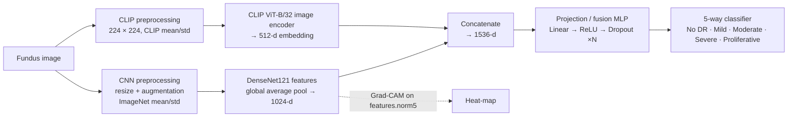
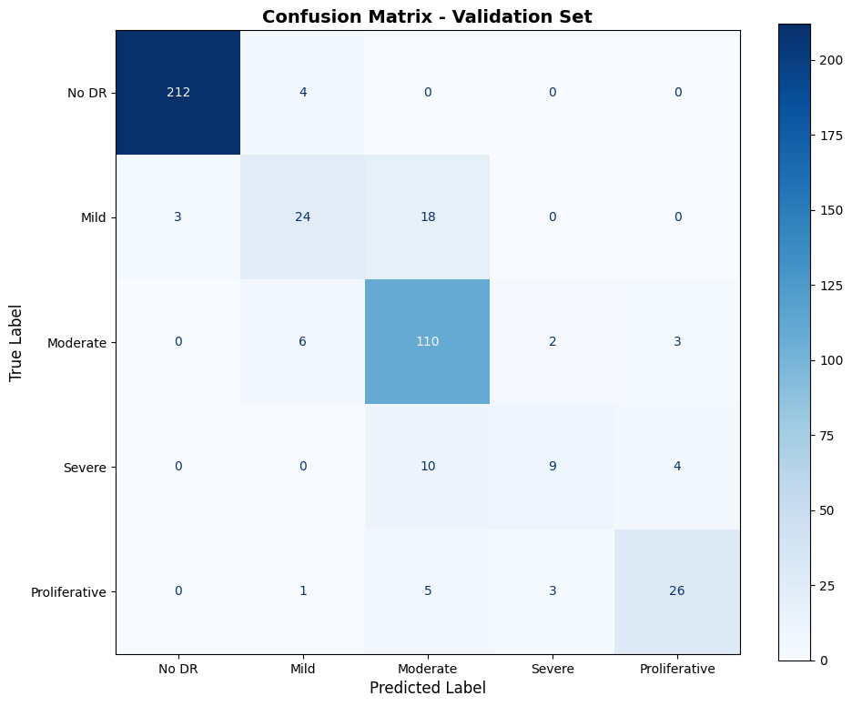
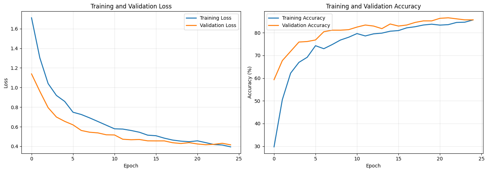
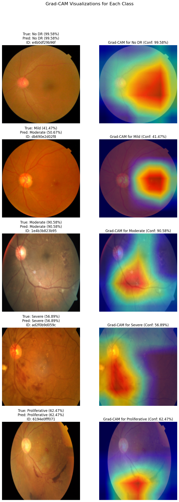

# Retinal Disease Detection

**Diabetic retinopathy grading from retinal fundus photographs using a feature-fusion network that combines the CLIP ViT-B/32 image encoder with DenseNet121, trained and evaluated on the APTOS 2019 Blindness Detection dataset.**

[](docs/Retinal_Disease_Detection_Report.pdf)
[](https://pytorch.org/)
[](https://huggingface.co/openai/clip-vit-base-patch32)
[](https://www.kaggle.com/competitions/aptos2019-blindness-detection/)

**Arun Kumar Pucha** · **Charan Teja Pampana**
Department of Artificial Intelligence, Indian Institute of Technology Kharagpur

📄 Full write-up: [docs/Retinal_Disease_Detection_Report.pdf](docs/Retinal_Disease_Detection_Report.pdf)

---

## Table of contents

1. [Overview](#overview)
2. [Key results](#key-results)
3. [Dataset](#dataset)
4. [Method](#method)
   - [Architecture](#architecture)
   - [Preprocessing and augmentation](#preprocessing-and-augmentation)
   - [Training configurations](#training-configurations)
5. [Results](#results)
6. [Explainability with Grad-CAM](#explainability-with-grad-cam)
7. [Repository structure](#repository-structure)
8. [Getting started](#getting-started)
9. [Future work](#future-work)
10. [Author contributions](#author-contributions)
11. [Citation](#citation)
12. [References](#references)

---

## Overview

Diabetic retinopathy (DR) is one of the leading causes of preventable blindness. Early detection can stop permanent vision loss, but ophthalmologists and specialised imaging equipment are scarce in many rural and under-served regions.

This project builds an automated DR screening model that grades a fundus photograph into one of five severity levels. Two complementary backbones are fused:

- **CLIP ViT-B/32** (`openai/clip-vit-base-patch32`) acts as the *big-picture* branch. Pre-trained on hundreds of millions of image–caption pairs, it supplies robust, global semantic features that are tolerant to illumination and capture-quality changes.
- **DenseNet121** acts as the *detail* branch. Its densely connected convolutional blocks are well suited to spotting small lesions such as microaneurysms, haemorrhages and exudates.

The two feature vectors are concatenated and passed through a projection/fusion MLP that produces the final diagnosis. Grad-CAM heat-maps on the DenseNet pathway show which retinal regions drove each prediction.

## Key results

Headline metrics on the held-out APTOS 2019 validation split (440 images), as reported in the paper (Table II):

| Metric | Score |
|---|---|
| Overall accuracy | **85.45 %** |
| Macro F1-score | 0.73 |
| Weighted F1-score | 0.85 |
| Quadratic Weighted Kappa (QWK) | **0.92** |

A QWK of 0.92 indicates strong agreement with expert grading. QWK is the standard metric for DR grading because it penalises errors in proportion to how far the predicted grade is from the true one.

Two training configurations were explored (see [Training configurations](#training-configurations)). The single-stage run reached a slightly higher raw accuracy of 86.59 % (Cohen's κ = 0.7953); the two-stage run gives the QWK of 0.92 above. Both notebooks, with their outputs, are in this repository.

## Dataset

**APTOS 2019 Blindness Detection** (Kaggle). The notebooks download the `mariaherrerot/aptos2019` Kaggle mirror through `kagglehub` and use its `train_1.csv`, which contains 2,930 labelled fundus images.

| Grade | Label | Images |
|---|---|---|
| 0 | No DR | 1,434 |
| 1 | Mild | 300 |
| 2 | Moderate | 808 |
| 3 | Severe | 154 |
| 4 | Proliferative | 234 |

The data is split **85 % / 15 %** with stratification on the grade (`random_state=42`), giving **2,490 training** and **440 validation** images. The class imbalance, especially the small Mild and Severe classes, is the main source of the per-class recall differences discussed in [Results](#results).

## Method

### Architecture



- **CLIP branch:** the vision tower of `openai/clip-vit-base-patch32`; `get_image_features` returns the 512-d projected embedding.
- **DenseNet branch:** torchvision `densenet121` with ImageNet weights; the classifier is removed and the final feature map is global-average-pooled to 1024-d.
- **Fusion head:** the concatenated 1536-d vector goes through a small MLP (Linear → ReLU → Dropout blocks) and a final linear layer with five outputs. Cross-entropy loss is used throughout.

### Preprocessing and augmentation

Training images for the DenseNet branch are augmented on the fly to simulate the variation seen across cameras, lighting and angles:

- Resize to a fixed square (224 px or 512 px depending on the configuration)
- Random horizontal flip (and vertical flip in the single-stage run)
- Random rotation of ±15°
- Colour jitter on brightness and contrast (plus saturation and hue in the single-stage run)
- ImageNet mean/std normalisation

Validation images are only resized and normalised. The CLIP branch always receives the image through CLIP's own preprocessing (224 × 224, CLIP mean/std).

### Training configurations

| | **Config A – single stage** | **Config B – two stage** |
|---|---|---|
| Notebook | [`CLIP_DenseNet_Fussion.ipynb`](CLIP_DenseNet_Fussion.ipynb) | [`clip_densenet_fusion_aptos_1.ipynb`](clip_densenet_fusion_aptos_1.ipynb) |
| CNN input size | 224 × 224 | 512 × 512 |
| CLIP weights | frozen | frozen in stage 1, unfrozen in stage 2 |
| DenseNet weights | trainable | frozen in stage 1; all but `norm0` / `denseblock1` trainable in stage 2 |
| Fusion head | 1536 → 512 → 256 → 128 → 5, BatchNorm + ReLU, dropout 0.5 / 0.35 / 0.25 | 1536 → 512 → 256 → 5, ReLU, dropout 0.4 / 0.3 |
| Optimiser | AdamW, lr 1e-4, weight decay 1e-4 | Stage 1: AdamW, lr 1e-3, wd 1e-4 · Stage 2: AdamW, lr 1e-5, wd 1e-6 |
| Schedule | Cosine annealing (T_max 50, η_min 1e-6), 25 epochs, early stopping patience 5 | 20 epochs linear probe + 20 epochs fine-tune |
| Batch size | 128 | 64 |
| Model selection | best validation accuracy (epoch 22) | best validation macro-F1 |
| Trainable parameters | 8.9 M of 160.2 M | up to 159.2 M |
| Best accuracy / kappa | 86.59 % / Cohen's κ 0.7953 | 85.45 % / QWK 0.9238 |

The two-stage recipe is the one described in the report: the decision layers are first trained on top of frozen backbones (*learning to interpret what the experts say*), then the whole network is fine-tuned at a much lower learning rate so DenseNet and CLIP can specialise for fundus images. Both runs were executed on a single NVIDIA A100 in Google Colab.

## Results

### Overall performance (Config B, reported in the paper)

| Metric | Score |
|---|---|
| Overall accuracy | 85.45 % |
| Macro F1-score | 0.7347 |
| Weighted F1-score | 0.8496 |
| Quadratic Weighted Kappa | 0.9238 |

### Class-wise performance (Config B, Table III of the report)

| Class (DR level) | Precision | Recall | F1-score | Support |
|---|---|---|---|---|
| 0 — No DR | 0.9682 | 0.9861 | 0.9771 | 216 |
| 1 — Mild | 0.6667 | 0.5778 | 0.6190 | 45 |
| 2 — Moderate | 0.7429 | 0.8595 | 0.7969 | 121 |
| 3 — Severe | 0.6667 | 0.4348 | 0.5263 | 23 |
| 4 — Proliferative | 0.8846 | 0.6571 | 0.7541 | 35 |

The model is highly accurate on the two most common clinical categories, No DR and Moderate DR. Mild and Severe cases have lower recall because of class imbalance and the subtle lesion differences between neighbouring grades. Class-balanced losses or more diverse samples for those grades are the obvious next steps.

### Confusion matrix and training curves (Config A)

The model rarely labels a healthy retina as diseased. Most confusion is between **Moderate ↔ Severe** and **Moderate ↔ Proliferative**, neighbouring stages that share similar lesion patterns.

<p align="center">
  
</p>

<p align="center">
  
</p>

Config A per-class scores for reference: No DR F1 0.9838, Mild 0.6000, Moderate 0.8333, Severe 0.4865, Proliferative 0.7647 (accuracy 86.59 %, macro F1 0.7337, weighted F1 0.8597).

### Comparison with published DR models (Table I of the report)

| Model | Reported score |
|---|---|
| AlexNet [1] | 97.9 % accuracy |
| DenseNet-121 [2] | 97.30 % accuracy |
| EfficientNet-B3 [3] | ~0.821 QWK |
| VGG16 [4] | 71.65 % accuracy |
| ResNet-50 [5] | 85.28 % accuracy |
| Vision Transformer [6] | 98.79 % accuracy |
| Custom CNN (CLAHE + ESRGAN) [7] | 98.36 % accuracy |
| **CLIP ViT-B/32 + DenseNet121 (this work)** | **86.59 % accuracy · 0.7953 Cohen's κ · 0.9237 QWK** |

The figures for other models are taken from the cited papers and were obtained on different splits, preprocessing pipelines and in some cases different datasets, so they are indicative rather than a like-for-like benchmark.

## Explainability with Grad-CAM

Gradient-weighted Class Activation Mapping (Grad-CAM) is applied to the DenseNet pathway (target layer `features.norm5`, the last normalisation layer before global pooling) using the `pytorch-grad-cam` library. Because the fusion model takes two inputs, a thin wrapper fixes the CLIP tensor so Grad-CAM can back-propagate through the CNN input alone.

The panel below shows one validation image per grade with the true and predicted labels and their confidence. Heat-maps concentrate on haemorrhages, vascular abnormalities and the macular region, which supports clinical trust in the predictions.

<p align="center">
  
</p>

## Repository structure

```
.
├── CLIP_DenseNet_Fussion.ipynb          # Config A: single-stage training, CLIP frozen, 224 px, Grad-CAM (with outputs)
├── clip_densenet_fussion.py             # Script export of the notebook above (Colab)
├── clip_densenet_fusion_aptos_1.ipynb   # Config B: linear probe → full fine-tune, 512 px, QWK (with outputs)
├── clip_densenet_fusion_aptos_1.py      # Script export of the notebook above (Colab)
├── assets/
│   ├── confusion_matrix.png             # Figure 1 of the report
│   ├── training_history.png             # Figure 2 of the report
│   └── gradcam_visualizations.png       # Figure 3 of the report
├── docs/
│   └── Retinal_Disease_Detection_Report.pdf
├── requirements.txt
├── .gitignore
└── README.md
```

The `.py` files are Google Colab exports and still contain `!pip install …` shell lines, so run the notebooks directly or strip those lines before executing the scripts as plain Python.

## Getting started

### Run in Google Colab (recommended)

The notebooks were developed in Colab on an A100. Open either one directly from this repository:

| Notebook | |
|---|---|
| Config A · single stage + Grad-CAM | [](https://colab.research.google.com/github/charanteja0017/Retinal-Disease-Detection/blob/main/CLIP_DenseNet_Fussion.ipynb) |
| Config B · two stage, QWK | [](https://colab.research.google.com/github/charanteja0017/Retinal-Disease-Detection/blob/main/clip_densenet_fusion_aptos_1.ipynb) |

Select a GPU runtime, then run all cells. The first cells install the dependencies and download the dataset with `kagglehub`.

### Run locally

```bash
git clone https://github.com/charanteja0017/Retinal-Disease-Detection.git
cd Retinal-Disease-Detection

python -m venv .venv
source .venv/bin/activate          # Windows: .venv\Scripts\activate
pip install -r requirements.txt
```

`kagglehub` needs Kaggle credentials to download the dataset. Either place your `kaggle.json` in `~/.kaggle/` or export them as environment variables:

```bash
export KAGGLE_USERNAME=<your-kaggle-username>
export KAGGLE_KEY=<your-kaggle-api-key>
```

Then launch Jupyter and run the notebook of your choice:

```bash
jupyter notebook CLIP_DenseNet_Fussion.ipynb
```

A CUDA GPU is strongly recommended. Config B trains at 512 × 512 with both backbones unfrozen and needs a large-memory GPU; reduce the batch size if you hit out-of-memory errors. Trained checkpoints (`best_model.pth`, `best_linear_probe.pth`, `best_finetune.pth`) are written to the working directory and are excluded from version control by `.gitignore`.

## Future work

1. **Dataset expansion** – train on larger and more diverse retinal datasets to generalise across populations and imaging devices.
2. **Lightweight deployment** – compress and optimise the model for edge or mobile platforms so it can run in field clinics.
3. **Clinical integration** – build a diagnostic interface for clinicians with automated report generation and referral recommendations.
4. **Multi-disease detection** – extend the model to glaucoma, cataract and age-related macular degeneration.
5. **Enhanced explainability** – go beyond Grad-CAM with methods such as attention rollout on the CLIP branch.
6. **Class imbalance** – class-balanced or ordinal losses to lift recall on the Mild and Severe grades.

## Author contributions

Based on the CRediT taxonomy (Table IV of the report).

| CRediT role | Arun Kumar Pucha | Charan Teja Pampana |
|---|---|---|
| Methodology | Lead | Support |
| Software (coding and implementation) | Support | Lead |
| Data curation | Support | Lead |
| Writing – review and editing | Lead | Support |
| Project administration | Support | Lead |

## Citation

If you use this work, please cite the report:

```bibtex
@techreport{pucha2025retinal,
  title       = {Retinal Disease Detection},
  author      = {Pucha, Arun Kumar and Pampana, Charan Teja},
  institution = {Department of Artificial Intelligence, Indian Institute of Technology Kharagpur},
  year        = {2025},
  note        = {CLIP ViT-B/32 + DenseNet121 feature fusion for diabetic retinopathy grading on APTOS 2019}
}
```

## References

1. M. W. A. Khan, M. M. Rahman, M. H. Kabir, "Diabetic Retinopathy Detection Using AlexNet," *IJACSA*, 2020.
2. G. Pranay et al., "Detection Analysis of Diabetic Retinopathy Using Modified DenseNet-121," *IEEE CVMI*, 2023.
3. APTOS 2019 Blindness Detection Challenge Discussion, Kaggle, 2019.
4. R. R. J. Mahendran et al., "Deep Learning for Diabetic Retinopathy Detection and Classification," *Journal of Healthcare Engineering*, 2023.
5. S. K. Biswas, S. B. Chatterjee, "Enhanced Model for Detection of Diabetic Retinopathy Using Deep Learning Techniques," *IJIRCS*, 2023.
6. S. M. R. Islam et al., "Transformer-Based Retinopathy Classification Framework," preprint, 2023.
7. N. R. M. S. D. Perera et al., "Enhanced Deep Learning Model for Diabetic Retinopathy Classification Using Image Enhancement Techniques," *Journal of Imaging*, 2023.
8. A. Radford et al., "Learning Transferable Visual Models from Natural Language Supervision," *ICML*, 2021.
9. G. Huang, Z. Liu, L. van der Maaten, K. Q. Weinberger, "Densely Connected Convolutional Networks," *CVPR*, 2017.
10. Kaggle, "APTOS 2019 Blindness Detection Dataset," 2019. https://www.kaggle.com/competitions/aptos2019-blindness-detection/
11. V. Gulshan et al., "Development and Validation of a Deep Learning Algorithm for Detection of Diabetic Retinopathy in Retinal Fundus Photographs," *JAMA*, 316(22), 2016.
12. F. Bianchi et al., "Contrastive Language–Image Pre-training for the Italian Language," arXiv:2108.08688, 2021.
13. "Vision-Language Models in Medical Imaging: A Survey," arXiv:2311.17315, 2023.
14. T. Y. Wong et al., "Diabetic Retinopathy: Epidemiology, Pathophysiology, and Risk Factors," *The Lancet*, 376(9736), 2010.
15. R. R. Selvaraju et al., "Grad-CAM: Visual Explanations from Deep Networks via Gradient-based Localization," *ICCV*, 2017.

The full reference list is in the [report](docs/Retinal_Disease_Detection_Report.pdf).
